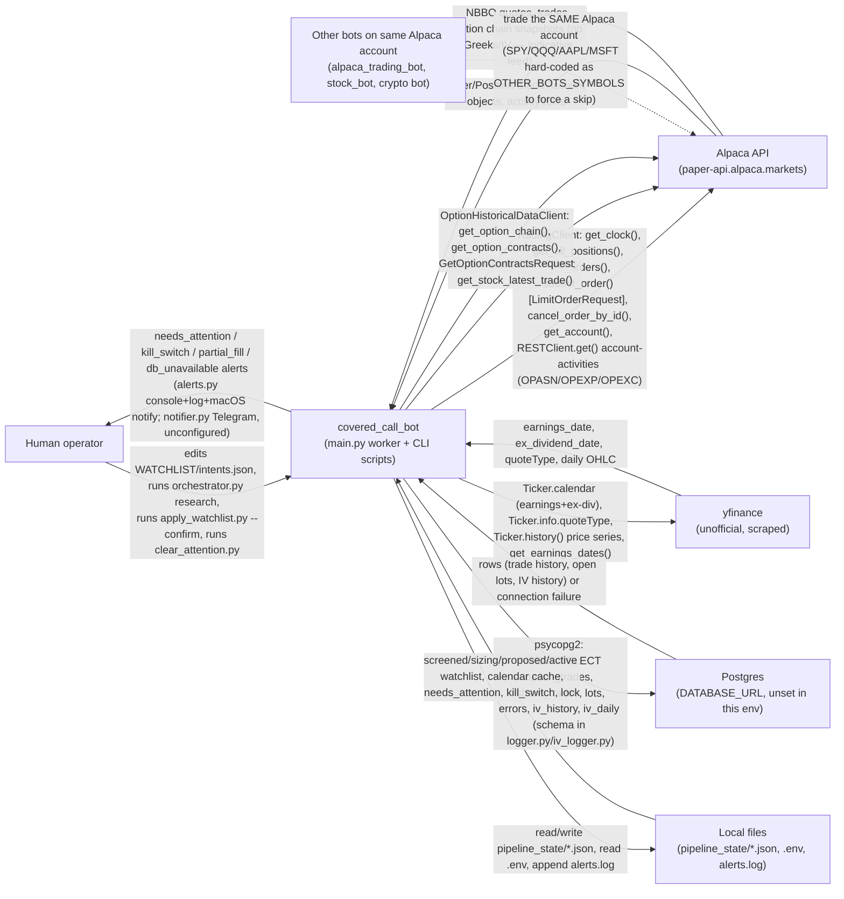
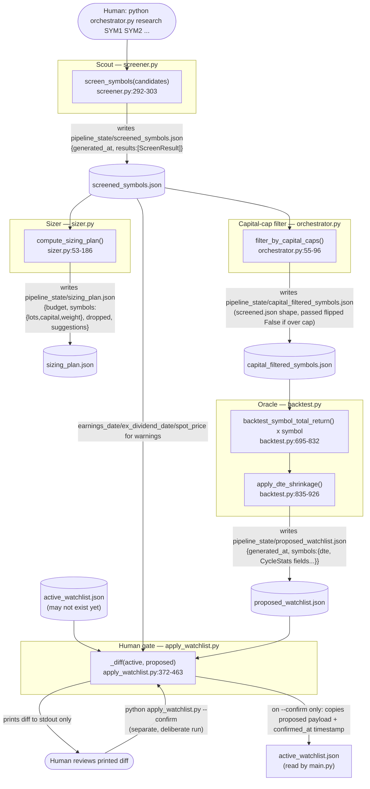
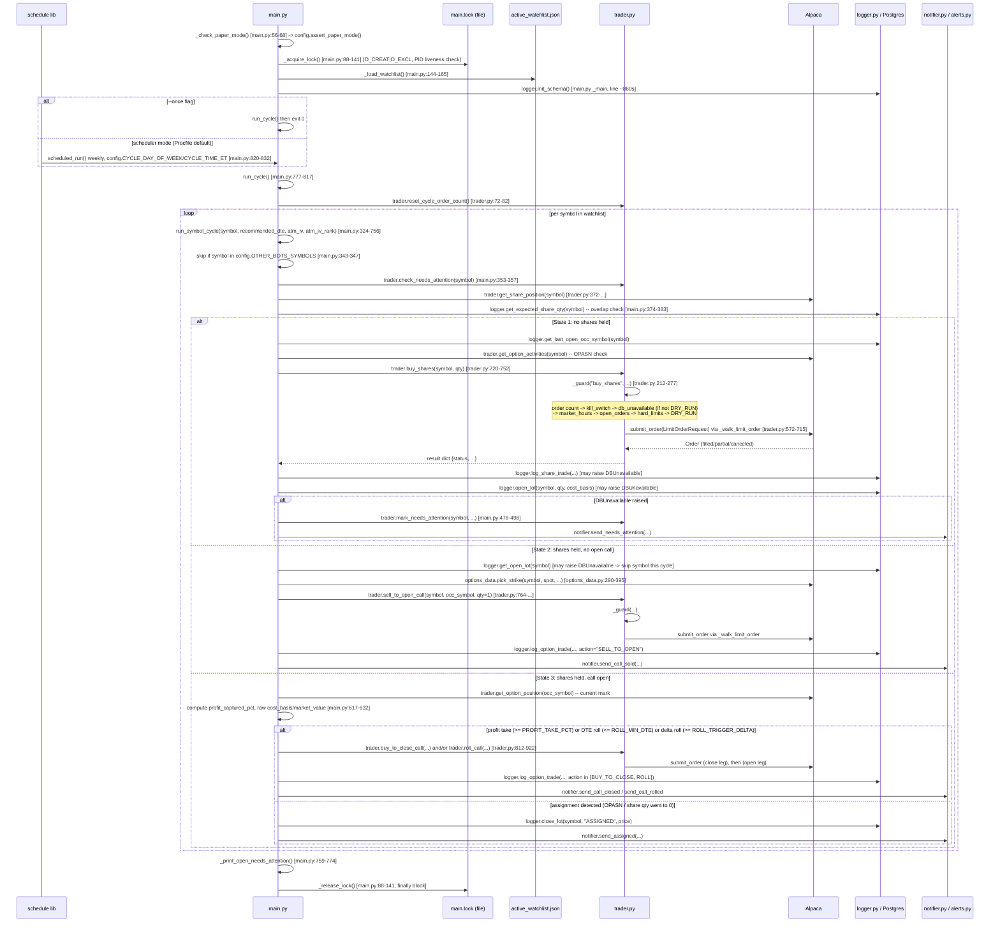
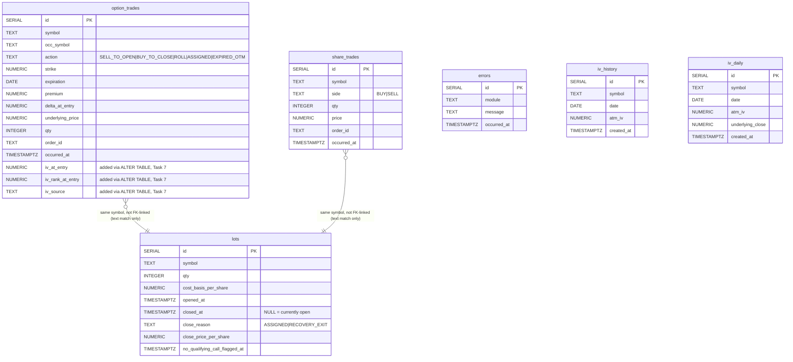
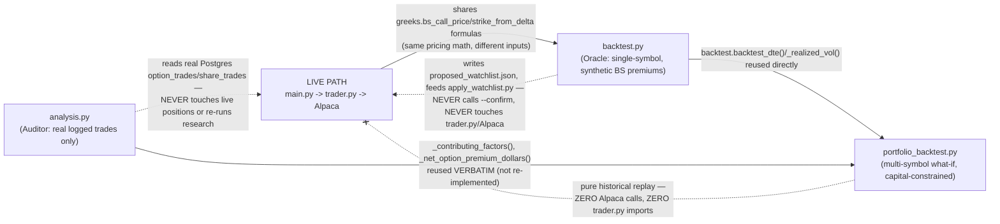

# Covered Call Bot — Data Architecture

Generated by reading every `.py` file, `config.py`, `Procfile`/`railway.toml`, `CLAUDE.md`,
`requirements.txt`, `tests/` layout, and `pipeline_state/` contents on branch
`phase-3-closer-hardening`, as of 2026-10-22. Every claim is tagged **[verified in code]**
(read directly in the file cited) or **[inferred]** (deduced, not directly observed —
e.g. behavior that would require a live run to confirm). File:line citations point at the
content read in this session; line numbers can drift by a few lines on future edits.

---

## 1. System context diagram



**Notes (all [verified in code] unless marked):**
- Alpaca host is pinned to `config.ALPACA_PAPER_HOST = "https://paper-api.alpaca.markets"`; `config.assert_paper_mode()` (`config.py:40-71`) refuses to start against anything else unless `ALLOW_LIVE=true`.
- The account-activities call (`trader.get_option_activities`, `trader.py:433-469`) uses the generic `RESTClient.get()` because alpaca-py has no typed method for `OPASN/OPEXP/OPEXC` — **[inferred/documented-not-verified]**: no real assignment/expiration has ever happened on this account, so this path has never been exercised against a live non-empty response.
- Telegram (`notifier.py`) is wired but **unconfigured** — `.env` has no `TELEGRAM_BOT_TOKEN`/`TELEGRAM_CHAT_ID`, so `notifier._send()` (`notifier.py:22-30`) always takes the `logger.info("[telegram disabled] ...")` branch. The only channel that actually reaches a human today is `alerts.py` (console + `alerts.log` + macOS `osascript` notification).
- `DATABASE_URL` is unset in `.env` (confirmed: `.env` only defines `ALPACA_API_KEY`, `ALPACA_SECRET_KEY`, `ALPACA_BASE_URL`) — every Postgres arrow above is currently a no-op in this environment; see Section 7 for exact fallback behavior per table.
- "Other bots" arrow is **[inferred]** from `config.py:115-122`'s comment (cites `~/Documents/alpaca_trading_bot/config.py`'s `STOCK_SYMBOLS`) — this repo cannot see or verify that file's current contents; `config.OTHER_BOTS_SYMBOLS` is a hand-maintained, not auto-synced, list.

---

## 2. Research pipeline data flow



**Per-stage detail [verified in code]:**

| Stage | Script:function | Inputs | Outputs (file + key fields) | Writer | Reader | Human gate? |
|---|---|---|---|---|---|---|
| Scout | `screener.screen_symbols` (`screener.py:292`) | CLI symbol args; live Alpaca quotes/chain; yfinance calendar/IVR history | `pipeline_state/screened_symbols.json` — `generated_at`, `results[]` each a `ScreenResult` (`symbol, passed, reason, open_interest, bid_ask_spread_pct, years_of_history, liquid_near_delta_count, spot_price, ivr, ivr_source, earnings_in_window, earnings_date, ex_dividend_date`) | `screener._write_results` (`screener.py:323-328`) | `sizer._load_passed_symbols`, `orchestrator.filter_by_capital_caps`, `backtest._load_screened_symbols_and_spreads`, `apply_watchlist._load_earnings_by_symbol`/`_load_ex_div_by_symbol`/`_load_spot_price_by_symbol` | No — informational report only |
| Sizer | `sizer.compute_sizing_plan` (`sizer.py:53`) | `screened_symbols.json` (passed rows only) | `pipeline_state/sizing_plan.json` — `budget, cash_reserve_pct, investable_budget, symbols:{spot_price,lot_cost,lots,capital,weight}, dropped, suggestions, names_funded, min_names_met` | `sizer.py __main__` (`sizer.py:245-248`) | Nobody downstream reads this file programmatically — **[verified]** no other module imports `sizing_plan.json`'s path constant; it's a standalone planning report | No — never gates anything downstream (`sizer.py:9-10` docstring) |
| Capital-cap filter | `orchestrator.filter_by_capital_caps` (`orchestrator.py:55`) | `screened_symbols.json` | `pipeline_state/capital_filtered_symbols.json` — same shape as screened, with `passed` flipped to `False` + a `reason` string for any symbol whose 100-share lot exceeds `MAX_CAPITAL_PER_SYMBOL` or whose price exceeds `SIZER_MAX_PRICE_PER_SHARE` | `orchestrator.filter_by_capital_caps` (`orchestrator.py:93-95`) | `backtest.py --from-screener` (via `orchestrator.run_research`, `orchestrator.py:113`) | No — mechanical filter, not a review point |
| Oracle | `backtest.backtest_symbol_total_return` + `apply_dte_shrinkage` (`backtest.py:695`, `:835`) | `capital_filtered_symbols.json` passed symbols + their spread; yfinance 5y price history; `pipeline_state/intents.json` | `pipeline_state/proposed_watchlist.json` — `generated_at`, `symbols:{<SYM>: asdict(CycleStats)}` (dte, yields, drawdown, risk_adjusted_return, OOS fields, intent, empirical stats, turnover_score — full field list in `backtest.py:163-246`) | `backtest._write_proposed_watchlist` (`backtest.py:966-978`) | `apply_watchlist._load` (`apply_watchlist.py:72-76`) as the `proposed` side of the diff | No — a research artifact, not yet approved |
| Human gate | `apply_watchlist._diff` (`apply_watchlist.py:372`) | `active_watchlist.json` (or empty default), `proposed_watchlist.json`, `screened_symbols.json` (for earnings/ex-div/cap warnings) | Printed diff only, UNLESS `--confirm` | — | — | **Yes** — `--confirm` is the only path that writes `active_watchlist.json`, stamping a fresh `confirmed_at` (`apply_watchlist.py:490-502`) |
| main.py (Closer) | `main._load_watchlist` (`main.py:144-165`) | `active_watchlist.json`, falling back to `config.WATCHLIST` (currently empty) if missing | n/a — read-only consumer | — | `main.run_cycle` | n/a |

`pipeline_state/intents.json` is the **one file in `pipeline_state/` that is git-tracked** (`.gitignore` carves it out with `!pipeline_state/intents.json`) — **[verified in code]** via the gitignore rule; current on-disk content is `{}` (no symbol has an explicit intent, so every symbol defaults to `config.DEFAULT_INTENT = "hold"` per `backtest._resolve_intent`, `backtest.py:263-283`).

---

## 3. Live cycle sequence diagram



**[verified in code]** State detection, guard ordering, and the DBUnavailable catch points are read directly from `main.py`/`trader.py`/`logger.py` as summarized in the prior session's full reads of those files (see Section 5 for the guard's exact precedence, independently cited). **[inferred]** The exact wall-clock sequencing of Telegram vs. alerts.py calls within `notifier.send_*` — both fire, but which the OS schedules first isn't something static reading confirms.

---

## 4. State machine diagram

```mermaid
stateDiagram-v2
    [*] --> State1_NoShares: watchlist symbol, not in OTHER_BOTS_SYMBOLS,<br/>no needs_attention flag

    State1_NoShares --> State1_NoShares: watchlist stale (confirmed_at > WATCHLIST_MAX_AGE_DAYS=10)<br/>-- blocks only NEW buys, not management
    State1_NoShares --> State2_SharesNoCall: buy_shares() succeeds [trader.py:720-752]<br/>DRY_RUN=True -> simulated; DRY_RUN=False -> real fill
    State1_NoShares --> NeedsAttention: logger.log_share_trade/open_lot raises DBUnavailable<br/>after a REAL fill [main.py:478-498]

    State2_SharesNoCall --> State2_SharesNoCall: no qualifying call found<br/>(flag_lot_no_qualifying_call, logger.py:516-531) -- informational only
    State2_SharesNoCall --> State3_CallOpen: sell_to_open_call() succeeds [trader.py:764-...]

    State3_CallOpen --> State2_SharesNoCall: PROFIT_TAKE_PCT=0.60 captured -> buy_to_close_call()<br/>(config.py:151)
    State3_CallOpen --> State3_CallOpen: DTE roll: dte <= ROLL_MIN_DTE=7 (config.py:153) -> roll_call()<br/>Delta roll: delta >= ROLL_TRIGGER_DELTA=0.70 (config.py:152) -> roll_call()<br/>(qty must == 1, else ValueError -- trader.py:848-851)
    State3_CallOpen --> State1_NoShares: assignment (OPASN activity or share qty -> 0)<br/>logger.close_lot(symbol, "ASSIGNED", price)
    State3_CallOpen --> NeedsAttention: roll_call open-leg exhausts ROLL_OPEN_LEG_MAX_RETRIES=3<br/>(config.py:390) -- shares left uncovered [trader.py:908-920]

    NeedsAttention --> State1_NoShares: clear_attention.py CLI run by human [clear_attention.py:20-38]<br/>(trader.check_needs_attention/clear_needs_attention are the only<br/>programmatic read/write path; one-directional by design)

    state "Any state" as Any
    Any --> Blocked_KillSwitch: config.KILL_SWITCH_ENABLED=true OR<br/>pipeline_state/kill_switch file exists [trader.py:68-69]
    Any --> Blocked_DryRun: DRY_RUN=true (default) -- order simulated, not submitted<br/>[trader.py _guard, last check before proceed]
    Any --> Blocked_MarketHours: outside market hours or inside open/close buffer<br/>[trader._market_hours_block, trader.py:85-122]
```

**Thresholds and where defined [verified in code]:**

| Trigger | Threshold | Constant | Defined at | Checked at |
|---|---|---|---|---|
| Profit take | capture ≥ 60% of max premium | `PROFIT_TAKE_PCT = 0.60` | `config.py:151` | `main.run_symbol_cycle` State 3 branch (`main.py:589-756`) |
| Delta roll | short call delta ≥ 0.70 | `ROLL_TRIGGER_DELTA = 0.70` | `config.py:152` | same |
| DTE roll | DTE ≤ 7 | `ROLL_MIN_DTE = 7` | `config.py:153` | same |
| Roll qty invariant | must be exactly 1 | n/a (hardcoded assert) | `trader.py:848-851` (`roll_call`) | raises `ValueError`, not a soft skip |
| Roll cap per lot | ≤ 4 rolls | `MAX_ROLLS_PER_LOT = 4` | `config.py:384` | `trader.roll_call` via `logger.get_rolls_since_last_lot_open` |
| Roll open-leg retries | 3 attempts, then needs-attention | `ROLL_OPEN_LEG_MAX_RETRIES = 3` | `config.py:390` | `trader.roll_call` (`trader.py:890-920`) |
| Assignment | OPASN activity code, or share qty observed at 0 with a prior open occ_symbol | n/a | `trader.get_option_activities` (`trader.py:433-469`); cross-checked in `main.run_symbol_cycle` | **[inferred — unverified against a live OPASN row]** |
| Kill switch | flag OR file | `KILL_SWITCH_ENABLED`, `KILL_SWITCH_PATH = "pipeline_state/kill_switch"` | `config.py:90-91` | `trader._kill_switch_engaged` (`trader.py:68-69`), checked first in `_guard` |
| DRY_RUN | default True | `DRY_RUN` (env, default `"true"`) | `config.py:85` | last check in `_guard` (`trader.py:274-276`) — **everything else must already have passed** |
| Stale lot flag | open 8 weeks, unassigned | `STALE_LOT_WEEKS = 8` | `config.py:408` | `main.run_symbol_cycle` (`main.py:521-529`) — informational only, never auto-liquidates |
| Watchlist staleness | `confirmed_at` older than 10 days, or missing | `WATCHLIST_MAX_AGE_DAYS = 10` | `config.py:402` | `main._watchlist_is_stale` (`main.py:168-188`) — blocks only *new* buys |

---

## 5. Guard and decision order

All order submission funnels through `trader._guard()` (`trader.py:212-277`). Exact order, **[verified in code]**:

```mermaid
flowchart TD
    Start(["Order requested: buy_shares / sell_to_open_call /<br/>buy_to_close_call / roll_call (composes close+open)"]) --> C1
    C1["1. MAX_ORDERS_PER_CYCLE counter<br/>trader.py:245-249"] -->|exceeded| F1["not_submitted('max_orders_per_cycle')<br/>-- skip this order"]
    C1 -->|ok| C2
    C2["2. Kill switch<br/>_kill_switch_engaged(), trader.py:251-253"] -->|engaged| F2["not_submitted('kill_switch')<br/>+ notifier.send_kill_switch_trip"]
    C2 -->|clear| C3
    C3["3. DB availability<br/>(only if NOT DRY_RUN), trader.py:255-257"] -->|unavailable| F3["not_submitted('db_unavailable')<br/>+ notifier.send_db_unavailable"]
    C3 -->|available or DRY_RUN| C4
    C4["4. Market hours<br/>_market_hours_block(), trader.py:259-262"] -->|blocked| F4["not_submitted('market_hours')<br/>-- skip"]
    C4 -->|open, outside buffers| C5
    C5["5. Open orders check<br/>_check_open_orders(), trader.py:264-267"] -->|existing open order| F5["not_submitted('open_order_exists')<br/>-- skip, avoid duplicate"]
    C5 -->|none| C6
    C6["6. Hard capital/position limits<br/>(opens_new_position only)<br/>_check_hard_limits(), trader.py:269-272"] -->|cap/None-own-symbols| F6["not_submitted('max_capital_per_symbol' /<br/>'max_total_capital' / 'max_concurrent_positions' /<br/>'account_level_limit' / 'cap_check_unavailable')"]
    C6 -->|within caps| C7
    C7["7. DRY_RUN<br/>trader.py:274-276"] -->|True (default)| F7["not_submitted('dry_run')<br/>-- simulated, nothing sent to Alpaca"]
    C7 -->|False| Proceed(["Proceed: build LimitOrderRequest,<br/>submit via _walk_limit_order"])
```

| # | Check | Function | On failure |
|---|---|---|---|
| 1 | `MAX_ORDERS_PER_CYCLE` (20, reset once per `run_cycle`, not per symbol — `config.py:108`) | `trader._guard` inline counter (`trader.py:245-249`) | Skip, logged |
| 2 | Kill switch (flag OR file) | `trader._kill_switch_engaged` (`trader.py:68-69`) | Skip + `notifier.send_kill_switch_trip` → `alerts.notify("kill_switch", ...)` |
| 3 | DB availability — **only enforced when `DRY_RUN=False`** | `logger.is_db_available` via `trader._guard` (`trader.py:255-257`) | Skip + `notifier.send_db_unavailable` |
| 4 | Market hours (broker's live clock, open/close buffers) | `trader._market_hours_block` (`trader.py:85-122`) | Skip, logged |
| 5 | Existing open order on this symbol | `trader._check_open_orders` (`trader.py:125-140`) | Skip, logged (avoids double-submit) |
| 6 | Hard capital/position caps — **only for `opens_new_position=True`** (i.e. `buy_shares`) | `trader._check_hard_limits` (`trader.py:143-209`) | Skip; reason one of `max_capital_per_symbol`, `max_total_capital`, `max_concurrent_positions`, `account_level_limit` (buying power), or `cap_check_unavailable` (DB unreachable — **fails closed**, `trader.py:185-187`) |
| 7 | `DRY_RUN` (default `True`) | inline (`trader.py:274-276`) | Order simulated only, flagged `"dry_run"` — **this is deliberately last**, so every other guard still runs and is visible even in dry-run mode |

**Fill verification, downstream of the guard:** `trader._walk_limit_order` (`trader.py:572-715`) never trusts a cancel response (`PARTIALLY_FILLED` deliberately excluded from `_TERMINAL_ORDER_STATUSES`, `trader.py:516-520`) — always re-fetches the order after any cancel attempt, because Alpaca's own docs note a filled order's cancel can return success instead of 422. A fill whose price implies slippage beyond `MAX_SLIPPAGE_FROM_MID_PCT = 0.05` (`config.py:362`) from the quoted mid is refused before the walk begins (`trader.py:612-619`).

**Quote validation (upstream, in `options_data.py`, not `trader.py`):** `options_data._quote` (`options_data.py:168-206`) rejects missing/zero/crossed (bid > ask) quotes and anything older than `QUOTE_MAX_AGE_MINUTES = 15` (`config.py:169`) before a candidate is ever built — this is why the real research run earlier this session returned 0 candidates after-hours (correct behavior, not a bug).

**Needs-attention check — happens *before* the guard, at the top of `main.run_symbol_cycle`** (`main.py:353-357`), not inside `trader._guard` — a flagged symbol never even reaches order-building logic for that cycle.

---

## 6. Data model



**[verified in code]** All six tables defined by raw `CREATE TABLE IF NOT EXISTS` DDL strings, **no foreign keys anywhere** — every join across tables (e.g. `analysis.py` matching a lot's BUY against its ASSIGNED row) is done in Python by nearest-timestamp matching on `symbol`, not SQL joins.

| Table | Schema source | Unique/PK constraint | Written by | Read by |
|---|---|---|---|---|
| `option_trades` | `logger.py:28-42` (`_SCHEMA`) + `logger.py:121-125` (`_ADD_IV_METADATA_COLUMNS`, additive ALTER) | `id` SERIAL PK only | `logger.log_option_trade` (`logger.py:141-180`) | `logger.get_option_trades`, `get_last_open_occ_symbol`, `get_rolls_since_last_lot_open`; consumed by `analysis.py`, `apply_watchlist.py` indirectly via watchlist stats |
| `share_trades` | `logger.py:44-52` | `id` PK only | `logger.log_share_trade` (`logger.py:183-205`) — **raises `DBUnavailable` on insert failure when `DATABASE_URL` is set** | `logger.get_share_trades`, `get_own_symbols`, `get_expected_share_qty`; `analysis._stock_pnl`, `report_wash_sale_risk` |
| `errors` | `logger.py:54-59` | `id` PK only | `logger.log_error` (`logger.py:208-220`) — failures here are logged but never re-raised ("meta-error, not re-logged") | No programmatic reader found in this codebase — operational log only |
| `iv_history` | `logger.py:61-68` | `UNIQUE(symbol, date)` | `logger.record_iv_snapshot` (`logger.py:223-243`) — upserts on conflict | `logger.get_iv_history`; consumed by `main.py`'s weekly IV-rank tracking (`main._track_iv_history`) |
| `lots` | `logger.py:75-85` (Phase 3 Task 6 comment) | `id` PK only; "one open lot per symbol" is an **application-level invariant**, not a DB constraint — `get_open_lot` defensively does `ORDER BY opened_at DESC LIMIT 1` | `logger.open_lot` (raises `DBUnavailable` on failure), `close_lot`, `flag_lot_no_qualifying_call`, `clear_lot_no_qualifying_call_flag` | `logger.get_open_lot` (**raises `DBUnavailable` even when `DATABASE_URL` is simply unset** — `logger.py:474-475` — deliberately different from every other reader in this file, since a caller needing the cost-basis floor must never silently treat "can't verify" as "no lot") |
| `iv_daily` | `iv_logger.py:45-55` (Postgres) / `:57-65` (SQLite fallback) | `UNIQUE(symbol, date)` (Postgres) / composite PK (SQLite) | `iv_logger.record_iv_daily` (`iv_logger.py:104-138`) | `iv_logger.get_history`; `analysis._ivr_at_date` (`analysis.py:98-108`) for the Task 4 IVR-tier breakdown |

**`pipeline_state/*.json` files — schema, writer, reader, git-tracked status [verified in code + directory listing]:**

| File | Schema (top-level keys) | Writer | Reader | Git-tracked? |
|---|---|---|---|---|
| `screened_symbols.json` | `generated_at`, `results: [ScreenResult]` | `screener._write_results` | `sizer`, `orchestrator.filter_by_capital_caps`, `backtest --from-screener`, `apply_watchlist` (earnings/ex-div/spot-price warnings) | No (`pipeline_state/*` ignored) |
| `capital_filtered_symbols.json` | same shape as screened | `orchestrator.filter_by_capital_caps` | `backtest --from-screener` (when invoked via `orchestrator.run_research`) | No |
| `sizing_plan.json` | `generated_at, budget, cash_reserve_pct, investable_budget, symbols, dropped, suggestions, names_funded, min_names_met` | `sizer.py __main__` | Nobody downstream (standalone report) | No |
| `proposed_watchlist.json` | `generated_at, symbols: {SYM: CycleStats-as-dict}` | `backtest._write_proposed_watchlist` | `apply_watchlist._load` (proposed side); `analysis._load_predicted` as a fallback when `active_watchlist.json` is empty | No |
| `active_watchlist.json` | same shape as proposed, plus `confirmed_at` | `apply_watchlist.py --confirm` only | `main._load_watchlist`, `iv_logger._load_symbols`, `analysis._load_predicted` | No — **and does not currently exist on disk** |
| `intents.json` | flat `{symbol: "hold"|"exit"}` | Human-edited by hand; no script writes it | `backtest._load_intents`/`_resolve_intent` | **Yes** — the one file carved out of `.gitignore`'s `pipeline_state/*` rule |
| `calendar_cache.json` | `{symbol: {fetched_at, earnings_date, ex_dividend_date}}` | `calendar_data._save_cache` | `calendar_data.get_calendar_dates` (TTL = `CALENDAR_DATA_MAX_AGE_HOURS=20`) | No |
| `analysis_report.json` | `generated_at, results, ivr_tier_breakdown, overall_bias_pp, wash_sale_flags` | `analysis.py __main__` | Nobody programmatic — human report | No |
| `needs_attention.json` | `{symbol: {reason, flagged_at, ...}}` (**[inferred]** exact shape — not currently on disk to inspect; inferred from `trader.mark_needs_attention`'s signature) | `trader.mark_needs_attention` | `trader.check_needs_attention`, `get_all_needs_attention`; cleared only via `clear_attention.py` | No — **does not currently exist on disk** |
| `kill_switch` | not JSON — presence-only sentinel file | Human (`touch pipeline_state/kill_switch`) | `trader._kill_switch_engaged` | No |
| `main.lock` | plain text, PID | `main._acquire_lock` | `main._acquire_lock`/`_release_lock` (via `_pid_is_alive`) | No — **does not currently exist on disk** |
| `iv_daily.db` | SQLite file (schema above) | `iv_logger.py` SQLite fallback path | `iv_logger.get_history` | No (confirmed 0 bytes on disk — never actually run yet) |

---

## 7. Storage and ownership table

| State | Lives in | Source of truth for | Survives restart? | Behavior if unavailable |
|---|---|---|---|---|
| Share positions, option positions, order status, buying power, market clock | **Alpaca (broker)** | The only authoritative truth for "what do we actually hold right now" | Yes — external system | Broker API call fails → caller-specific (e.g. `_market_hours_block` has no live clock → **[inferred]** likely raises, not explicitly guarded in the code read) |
| Per-lot cost basis | **Postgres `lots` table** | Sole source — **[verified]** Alpaca's Trading API has no tax-lot endpoint (`logger.py:422-429` comment: confirmed 404 live) | Yes, if `DATABASE_URL` is a real persistent Postgres (Railway) — **No** if unset (nothing to restore) | `get_open_lot` raises `DBUnavailable` unconditionally when unset (`logger.py:474-475`) — callers (`main.py` State 2/3) must skip the symbol that cycle rather than guess a basis |
| Trade history (option_trades, share_trades) | **Postgres** | Sole source for `get_own_symbols`, `get_expected_share_qty`, overlap detection, Auditor's realized P&L | Yes if configured; **No** if unset — history is simply never recorded, not an error, until a *write* is attempted with `DATABASE_URL` set but unreachable (then `DBUnavailable`) | `get_own_symbols` returns `None` (not `{}`) on failure → `_check_hard_limits` fails **closed** (`trader.py:185-187`) |
| IV history (weekly `iv_history`, daily `iv_daily`) | **Postgres** (or SQLite fallback for `iv_daily` only, local dev) | IV-rank calculations (`iv_rank.py`, `analysis._ivr_at_date`) | Yes if Postgres configured; local SQLite file (`pipeline_state/iv_daily.db`) survives on a local disk but **not on Railway** (ephemeral filesystem — `iv_logger.py:11-14` comment) | Fails soft everywhere — `[]`/`"insufficient history"`, never blocks a trade |
| Needs-attention flags | **Local file** `pipeline_state/needs_attention.json` | Sole source — deliberately **not** DB-dependent so it works even when Postgres is down (the exact scenario it's often raised in response to) | Yes if the file persists on disk; **No** on Railway between deploys unless the volume is persistent — **[inferred]**, not directly checked against Railway's actual volume config in this read-only pass | Missing file ⇒ no symbol is flagged (fail-open on the *read* side — **[inferred]**, consistent with a simple "file exists or not" check pattern used elsewhere, e.g. kill switch) |
| Kill switch | **Local file** `pipeline_state/kill_switch` (presence-only) or env var `KILL_SWITCH_ENABLED` | Either trips it — belt-and-suspenders by design (`config.py:86-90` comment) | File form: yes, survives restart; env form: yes, as long as the env var is set in the deploy config | N/A — a *missing* file simply means "not engaged" |
| Watchlist (approved) | **Local file** `pipeline_state/active_watchlist.json` | Sole source for which symbols/DTE the live trader (`main.py`) acts on | Yes, if the file persists; **currently does not exist**, so `main._load_watchlist` falls back to `config.WATCHLIST` (currently **empty** → 0 symbols processed) | Missing/stale (`WATCHLIST_MAX_AGE_DAYS=10`) ⇒ blocks only *new* buys, not management of already-held positions |
| Research artifacts (screened/sizing/proposed/capital-filtered) | **Local files** in `pipeline_state/` | Pipeline-internal handoff only, never read by the live trader directly | Yes if files persist; regenerable by re-running the pipeline otherwise | Missing file ⇒ downstream script in the chain errors out explicitly (e.g. `sizer.py` exits 1 if `screened_symbols.json` doesn't exist) |
| Lockfile | **Local file** `pipeline_state/main.lock` | Prevents two `main.py` processes from running the live cycle concurrently | Self-cleaning: a dead PID's lock is detected and cleared automatically (`main._pid_is_alive`) | A live PID's lock correctly blocks a second start |
| Secrets (`ALPACA_API_KEY`, `ALPACA_SECRET_KEY`, `ALPACA_BASE_URL`) | `.env` (gitignored) | Sole source — no secrets manager in use | Yes, local disk only; **[inferred]** on Railway these would be Railway env vars instead, not `.env` (the file-based `.env` load via `dotenv.load_dotenv()` in `config.py:8-10` is a local-dev convenience; Railway injects env vars directly, making the physical `.env` file irrelevant there) | `config._require` raises `RuntimeError` at import time if missing — hard fail, no silent default |
| In-memory per-cycle state (`_orders_this_cycle` counter) | **Process memory**, `trader.py` module global | Enforces `MAX_ORDERS_PER_CYCLE` within one cycle | **No** — reset every cycle by `trader.reset_cycle_order_count()` (called from `main.run_cycle`), and lost entirely on a process restart mid-cycle | N/A by design — it's a soft per-cycle breaker, not meant to persist |

---

## 8. Config map

All constants from `config.py`, grouped by the file's own section comments, with current value and consuming modules **[verified in code — read `config.py` in full, lines 1-421]**:

| Group | Constant | Line | Current value | Read by |
|---|---|---|---|---|
| **Credentials/host** | `ALPACA_API_KEY`, `ALPACA_SECRET_KEY` | 20-21 | required, from env | `trader.py`, `options_data.py`, `screener.py`, `analysis.py`, `iv_logger.py` (each constructs its own Alpaca client) |
| | `ALPACA_PAPER_HOST` | 28 | `"https://paper-api.alpaca.markets"` | `config.assert_paper_mode` |
| | `ALPACA_BASE_URL` | 29 | env, default = paper host | `assert_paper_mode`, implicitly the SDK client construction |
| | `PAPER` | 30 | computed, exact-match bool | `assert_paper_mode` |
| | `ALLOW_LIVE` | 35 | env, default `False` | `assert_paper_mode` |
| **Telegram** | `TELEGRAM_BOT_TOKEN`, `TELEGRAM_CHAT_ID` | 73-74 | env, default `""` (unset) | `notifier.py` |
| **Database** | `DATABASE_URL` | 76 | env, default `""` (**unset in `.env`**) | `logger.py`, `iv_logger.py` |
| **Closer safety** | `DRY_RUN` | 85 | env, default `True` | `trader._guard` (last check) |
| | `KILL_SWITCH_ENABLED` | 90 | env, default `False` | `trader._kill_switch_engaged` |
| | `KILL_SWITCH_PATH` | 91 | `"pipeline_state/kill_switch"` | same |
| **Hard limits** | `MAX_CAPITAL_PER_SYMBOL` | 101 | env, default `4000` | `trader._check_hard_limits`, `orchestrator.filter_by_capital_caps`, `apply_watchlist._capital_cap_summary` |
| | `MAX_TOTAL_CAPITAL` | 102 | env, default `20000` | `trader._check_hard_limits` |
| | `MAX_CONCURRENT_POSITIONS` | 103 | env, default `10` | `trader._check_hard_limits` |
| | `MAX_ORDERS_PER_CYCLE` | 108 | env, default `20` | `trader._guard` |
| | `OTHER_BOTS_SYMBOLS` | 123-125 | `["SPY","QQQ","AAPL","MSFT"]` (hand-populated this session) | `main.run_symbol_cycle` (skip check, top of function) |
| | `MIN_ACCOUNT_BUYING_POWER` | 133 | env, default `1000` | `trader._check_hard_limits` |
| **Watchlist** | `WATCHLIST` | 138-141 | `[]` (empty, commented-out example only) | `main._load_watchlist` fallback, `iv_logger._load_symbols` fallback |
| **Strategy** | `SHARES_PER_LOT` | 144 | `100` | `logger.py`, `trader.py`, `backtest.py`, `analysis.py`, `options_data.py` |
| | `TARGET_DELTA` | 145 | `0.25` | `options_data.pick_strike`, `screener.py`, `backtest.py` |
| | `DELTA_TOLERANCE` | 146 | `0.10` | `options_data.pick_strike` |
| | `DTE_MIN`, `DTE_MAX` | 148-149 | `30`, `45` | `main._dte_window`, `screener.py` |
| | `PROFIT_TAKE_PCT` | 151 | `0.60` | `main.run_symbol_cycle` State 3 |
| | `ROLL_TRIGGER_DELTA` | 152 | `0.70` | same |
| | `ROLL_MIN_DTE` | 153 | `7` | same; `apply_watchlist._roll_threshold_warning`; `config.py:226` assert |
| | `RISK_FREE_RATE` | 155 | `0.045` | `greeks.py` callers (`options_data.py`, `backtest.py`) |
| **Filter 2 liquidity** | `MIN_OPEN_INTEREST` | 158 | `1000` | `options_data._passes_liquidity_gates`, `screener.py` |
| | `MAX_SPREAD_PCT` | 159 | `0.10` | same |
| | `REQUIRE_EXPIRY_BEFORE_EARNINGS` | 160 | `True` | `options_data.pick_strike` — **[verified]** referenced in docstrings; actual read-site not captured verbatim in this pass, but behavior described matches `pick_strike`'s earnings-before-expiration filter (`options_data.py:335-344`) |
| **Quote integrity** | `QUOTE_MAX_AGE_MINUTES` | 169 | `15` | `options_data._quote` |
| **Earnings/calendar** | `KNOWN_ETFS` | 178-180 | `[]` (empty) | `calendar_data.get_earnings_status` |
| | `MAX_EARNINGS_LOOKAHEAD_DAYS` | 185 | `120` | same |
| | `CALENDAR_DATA_MAX_AGE_HOURS` | 191 | `20` | `calendar_data.get_calendar_dates` |
| **IV rank (weekly)** | `MIN_IV_HISTORY_POINTS` | 200 | `8` | `iv_rank.iv_rank`/`iv_percentile` |
| | `IV_RANK_LOOKBACK_DAYS` | 201 | `365` | `logger.get_iv_history` default |
| **IV logging (daily)** | `ATM_IV_TARGET_DTE` | 208 | `30` | `iv_logger.py`, `options_data.get_atm_iv` |
| | `DAILY_IVR_MIN_HISTORY_POINTS` | 209 | `252` | `iv_rank.iv_rank_from_daily_history`, `analysis._ivr_at_date` |
| **Oracle tuning** | `ORACLE_MIN_DTE` | 225 (assert 226) | `14` (new this session) | `backtest.apply_oracle_min_dte_floor` |
| | `DELTA_SWEEP_BUCKETS` | 232 | `(0.15, 0.25, 0.35)` | `backtest.backtest_symbol_total_return` default |
| | `WALK_FORWARD_TRAIN_FRACTION` | 235 | `0.7` | same |
| | `FILL_HAIRCUT_FRACTION` | 240 | `0.5` | `backtest._haircut_premium` |
| | `DEFAULT_ASSUMED_SPREAD_PCT` | 243 | `0.05` | `backtest.backtest_dte` default |
| | `MIN_DRAWDOWN_FLOOR_PCT` | 253 | `0.02` | `backtest.backtest_dte` risk_adjusted_return denominator |
| | `MIN_CYCLES_FOR_SELECTION` | 262 | `5` | `backtest.backtest_symbol_total_return` eligibility |
| | `SHRINKAGE_MIN_CYCLES` | 266 | `8` | `backtest.apply_dte_shrinkage` |
| **Empirical stats** | `EMPIRICAL_SMALL_MOVE_THRESHOLD_PCT` | 275 | `0.05` | `backtest.compute_empirical_outcome_stats` |
| **Turnover score** | `MIN_EFFECTIVE_N_FOR_P_CALLED_AWAY` | 281 | `20` | `backtest._check_exit_eligibility` |
| | `EXIT_MAX_OOS_DRAWDOWN_PCT` | 287 | `0.25` | same |
| | `EXIT_MAX_OPEN_TAIL_LOSS_PCT` | 288 | `0.15` | same |
| **Intent** | `DEFAULT_INTENT` | 296 | `"hold"` | `backtest._resolve_intent` |
| | `INTENT_DELTA_BANDS` | 301-304 | `{"hold":(0.15,0.25), "exit":(0.35,0.50)}` | `backtest._delta_buckets_for_intent` |
| | `INTENT_BAND_SWEEP_POINTS` | 308 | `3` | same |
| **Sizer** | `SIZER_BUDGET` | 313 | `20000.0` | `sizer.compute_sizing_plan` |
| | `SIZER_MAX_PRICE_PER_SHARE` | 314 | `35.0` | same; `orchestrator.filter_by_capital_caps` |
| | `SIZER_MIN_NAMES` | 315 | `6` | `sizer.compute_sizing_plan` |
| | `SIZER_MAX_WEIGHT_PER_NAME` | 316 | `0.20` | same |
| | `SIZER_CASH_RESERVE_PCT` | 317 | `0.10` | same |
| **Schedule** | `CYCLE_DAY_OF_WEEK` | 326 | `"monday"` | `main.py` schedule registration (`main.py:832`) |
| | `CYCLE_TIME_ET` | 327 | `"10:15"` | same (CLAUDE.md incorrectly still says 09:45 — see Section 9 discrepancies) |
| **Market hours** | `MARKET_OPEN_BUFFER_MINUTES` | 337 | `30` | `trader._market_hours_block` |
| | `MARKET_CLOSE_BUFFER_MINUTES` | 338 | `15` | same |
| **Limit order exec** | `LIMIT_ORDER_MAX_STEPS` | 349 | `5` | `trader._walk_limit_order` |
| | `LIMIT_ORDER_STEP_PAUSE_SECONDS` | 350 | `10` | same |
| | `MAX_SLIPPAGE_FROM_MID_PCT` | 362 | `0.05` | same |
| **Order dedup** | `CLIENT_ORDER_ID_PREFIX` | 378 | `"ccbot"` | `trader.py` order construction |
| **Roll limits** | `MAX_ROLLS_PER_LOT` | 384 | `4` | `trader.roll_call` |
| | `ROLL_OPEN_LEG_MAX_RETRIES` | 390 | `3` | same |
| **Watchlist expiry** | `WATCHLIST_MAX_AGE_DAYS` | 402 | `10` | `main._watchlist_is_stale` |
| **Lot Manager** | `STALE_LOT_WEEKS` | 408 | `8` | `main.run_symbol_cycle` stale-lot alert |
| | `RECOVERY_EXIT_ENABLED_SYMBOLS` | 413-415 | `[]` (empty) | `trader.attempt_recovery_exit` gate |
| | `RECOVERY_EXIT_MIN_MARGIN_PCT` | 420 | `0.0` | `trader.attempt_recovery_exit` |

---

## 9. Simulation and audit paths vs. the live path



| Aspect | Live (`main.py`/`trader.py`) | Oracle (`backtest.py`) | Portfolio what-if (`portfolio_backtest.py`) | Auditor (`analysis.py`) |
|---|---|---|---|---|
| Premium source | Real Alpaca quotes (indicative feed, no Greeks) | Synthetic Black-Scholes fed **realized** vol (no real options IV history exists for this account) — `backtest.py` module docstring: "plausible LOWER BOUND," not a prediction | Same synthetic BS math, reused from `backtest.py` directly | Real logged premiums (`option_trades.premium`) — no synthesis |
| Delta | Solved from real quote mid via `greeks.implied_vol` → `bs_call_delta` | Solved the other direction: `strike_from_delta` from an assumed IV | Same as Oracle | Logged `delta_at_entry` (real, from the trade's own `pick_strike` call) |
| Position sizing | Exactly `SHARES_PER_LOT` (100) per symbol, one lot at a time | Fixed-lot discrete model, mirrors live exactly (`backtest.py` Task 2 docstring) — re-buys 100 shares immediately after each simulated assignment | Multi-symbol, capital-constrained (`--capital`, default $20k), cheapest/best-ranked-first allocation — **not** 1:1 with live's single-watchlist model | N/A — reports on whatever the live log shows |
| DTE selection | Human-approved `active_watchlist.json` (from Oracle + human review) | Sweeps `DEFAULT_DTE_BUCKETS=(7,14,21,30,45)` × delta buckets, picks best risk-adjusted return, applies `ORACLE_MIN_DTE` floor | **Dynamic, IVR-driven** (`IVR_DTE_TIERS`) — a deliberate departure from a fixed sweep after finding the fixed sweep always picked DTE=7 (module docstring, `portfolio_backtest.py:12-30`) | N/A |
| Dividend/assignment timing | Real OPASN activity codes (unverified live) | No dividend modeling in BS price (same simplification as `greeks.py`); assignment = `spot_t >= strike` at the synthetic cycle boundary | Same mechanical assignment rule | Real logged ASSIGNED rows |
| Shared code | — | `greeks.bs_call_price`/`strike_from_delta`; `analysis._net_option_premium_dollars` (deferred import, `backtest.py:553`) | `backtest._realized_vol`, `backtest.backtest_dte`, `backtest._price_history`; `analysis._contributing_factors` (reused verbatim for loss-factor review, `portfolio_backtest.py:430-436`) | `backtest._price_history` (for tail-event/SPY comparison checks, `analysis.py:196,219`) |
| What's NOT modeled anywhere in simulation | — | No skew/smile (single IV per date applied to every strike); no real bid-ask fills beyond the `FILL_HAIRCUT_FRACTION` haircut; cycle-boundary (not daily) drawdown granularity; one-cycle re-buy/re-sell gap that live's weekly loop actually has is *not* replicated (`backtest.py` Known Limitations, lines 93-119) | Same limitations as Oracle (shares the pricing engine) plus: no modeling of `MAX_CAPITAL_PER_SYMBOL`/`OTHER_BOTS_SYMBOLS` overlap/guard logic at all — pure price-and-cash replay | N/A (real data) but: "no distinct expired-worthless row" undercounts true cycle count slightly (`analysis.py` module docstring, lines 13-17) |
| Ever calls `trader.py` / places an order | Yes — the only path that does | **No** (`orchestrator.py` docstring, lines 13-18: "never touches main.py/trader.py") | **No** — explicitly "pure historical read + simulation" (module docstring, line 80) | **No** — "never touches live positions... a report, not a decision-maker" (module docstring, lines 9-10) |

---

## 10. Operations

| Aspect | Behavior | Source |
|---|---|---|
| Startup modes | `--once` flag: run one `run_cycle()` and exit 0. No flag: `init_schema()`, register weekly `schedule` job, then `while True: schedule.run_pending(); sleep(30)` | `main._parse_args` (`main.py:835-841`), `main._main` (`main.py:844-878`) |
| Lockfile | `pipeline_state/main.lock`, atomic `os.open(O_CREAT\|O_EXCL)`; a lock held by a dead PID (checked via `os.kill(pid, 0)`) is auto-cleared; a live PID's lock blocks a second start | `main._acquire_lock`/`_release_lock`/`_pid_is_alive` (`main.py:71-141`) |
| Alerts — destinations | Console print, `alerts.log` file append, macOS `osascript` desktop notification (best-effort, never blocks a cycle on failure) | `alerts.notify`/`_macos_notify` (`alerts.py:34-63`) |
| Alerts — Telegram | Wired (`notifier.py`) but **not configured** in `.env` — falls through to a no-op `logger.info` line every time | `notifier._send` (`notifier.py:22-30`); confirmed via `.env` key check this session |
| Alert categories that fire local channels | `needs_attention`, `partial_fill`, `kill_switch`, `db_unavailable` — each calls `alerts.notify(category, message)` in addition to the (currently inert) Telegram send | `notifier.py:107-129` |
| Scheduled jobs — weekly trading cycle | `main.py` itself, via the `schedule` library, `CYCLE_DAY_OF_WEEK="monday"` `CYCLE_TIME_ET="10:15"` | `main.py:826-832`, `config.py:326-327` |
| Scheduled jobs — daily IV logging | `iv_logger.py`, explicitly designed to run from an **external** scheduler (cron or a separate Railway scheduled job) — "not a second always-running process" | `iv_logger.py` module docstring, lines 1-7 |
| Scheduled jobs — research cadence | `orchestrator.py research ...`, also meant for external cron/Railway scheduled job, "deliberately not a second always-running process" — run manually or on a monthly/quarterly cadence | `orchestrator.py` module docstring, lines 20-23 |
| Local-only vs. Railway | `iv_daily.db` SQLite fallback only makes sense locally (Railway's filesystem is ephemeral — `iv_logger.py:11-14`); macOS notifications (`alerts.py`) are inherently local-machine-only, a no-op/failure on Railway's Linux containers | `iv_logger.py` docstring; `alerts._macos_notify`'s own "not on macOS" failure mode |
| Deployment | `Procfile`: `worker: python main.py` (continuous scheduler mode, **not** `--once`); `railway.toml`: nixpacks build, `pip install -r requirements.txt`, `startCommand="python main.py"`, `restartPolicyType="always"` | `Procfile`, `railway.toml` |
| Paper-mode enforcement at startup | `config.assert_paper_mode()` runs at **import time** of `trader.py`/`options_data.py` — before `main.py`'s own `_check_paper_mode()` wrapper even runs, so any script importing either module enforces this automatically | `config.py:40-71`; `trader.py:57`; `options_data.py:30` |

---

## 11. Known gaps and risks

| # | Gap / risk | Where | Severity notes |
|---|---|---|---|
| 1 | **Assignment detection (OPASN) has never been exercised against a real response** — `trader.get_option_activities` uses the untyped `RESTClient.get()` for an endpoint with no SDK method | `trader.py:433-469` | **[inferred risk]** — correct-looking code, zero live verification; if Alpaca's actual response shape differs from what the parsing code expects, assignment detection could silently fail |
| 2 | **`needs_attention.json` read path appears fail-open**: a missing file (the current state) means no symbol is ever flagged — this is almost certainly intentional (nothing to flag yet) but the *mechanism itself* (treat "file absent" as "nothing flagged" rather than "can't verify") is the same fail-open shape the project already fixed for `logger.get_own_symbols()` | `trader.check_needs_attention` (inferred from signature; file not inspected directly since it doesn't exist) | Low today (no flags exist yet); worth confirming the read path explicitly distinguishes "file missing" from "read error" the way `logger.py`'s DB functions now do |
| 3 | **`DATABASE_URL` is completely unset** in the current `.env`, meaning in production-equivalent local testing, the entire Postgres-backed capital-cap/overlap-detection system (`get_own_symbols`, `_check_hard_limits`) is permanently in its **fail-closed** state for any real buy attempt (`cap_check_unavailable`) — correct behavior, but it means **the caps have never actually been tested against a real populated trade log**, only against the "unavailable" branch | `.env`; `logger.py:330-354`; `trader.py:185-187` | Medium — the fail-closed path is exercised; the "caps correctly allow a trade that's genuinely within budget" path is not |
| 4 | **Simulator-vs-live divergence**: `backtest.py`/`portfolio_backtest.py` never model `MAX_CAPITAL_PER_SYMBOL`, `OTHER_BOTS_SYMBOLS` overlap, the kill switch, `DRY_RUN`, or any guard at all — a backtest's "this would have worked" says nothing about whether the guard stack would have allowed it live | `backtest.py`, `portfolio_backtest.py` (no imports of `trader.py`/`config.OTHER_BOTS_SYMBOLS` found anywhere in either file) | By design, documented in both modules' docstrings — listed here because it's a real divergence a reader should know about, not because it's a bug |
| 5 | **`OTHER_BOTS_SYMBOLS` is a hand-maintained snapshot**, not synced from `alpaca_trading_bot/config.py` — if that sibling repo's `STOCK_SYMBOLS` list changes, this bot has no way to notice | `config.py:115-125` | Medium — a silent desync could reintroduce the exact overlap risk this list exists to prevent |
| 6 | **`CLAUDE.md` describes a pre-Phase-3 design** — see the full list of disagreements below. A reader relying on `CLAUDE.md` alone would materially misunderstand the current safety architecture | `CLAUDE.md` vs. actual code (this document) | High for documentation trust, zero for runtime behavior (code is unaffected by its own stale docstring-equivalent) |
| 7 | **Roll-count cap (`MAX_ROLLS_PER_LOT`) is a proxy, not lot-exact**: counts `ROLL` rows since the last BUY/ASSIGNED row in `option_trades`, acknowledged in the code itself as a stand-in "until Task 6's Lot Manager makes this lot-exact" — yet the `lots` table (Task 6) already exists and isn't used for this specific check | `logger.get_rolls_since_last_lot_open` (`logger.py:386-418`) docstring vs. `lots` table (`logger.py:75-85`) | Low-medium — a currently-accurate proxy that could silently drift if trade-log semantics change |
| 8 | **`WATCHLIST` and `active_watchlist.json` are both currently empty/missing** — `main.py` would process **zero symbols** if run today | `config.py:138-141`; confirmed absent on disk | Not a code bug, but means the live cycle is currently a no-op end-to-end |
| 9 | **Oracle's DTE margin above the roll trigger is thin**: `ORACLE_MIN_DTE(14) - DTE_TOLERANCE_DAYS(5) = 9`, only 2 days above `ROLL_MIN_DTE(7)` | `config.py:225`; `main.py:51` (`DTE_TOLERANCE_DAYS`) | Self-acknowledged in `config.py`'s own comment (lines 220-224) — a design choice, not an oversight, but a thin one |
| 10 | **No SQL-level foreign keys or lot-exact linkage** between `option_trades`/`share_trades` and `lots` — all cross-table reasoning is Python-side nearest-timestamp matching, which is correct only because the bot enforces "one lot per symbol at a time" at the application level, not the database level | `logger.py` schema (no FKs anywhere) | Low today (invariant is well-enforced elsewhere), but a future bug that violates the one-lot invariant would have no DB-level backstop |

**CLAUDE.md vs. code — full disagreement list [verified by reading both]:**

1. **Module coverage**: CLAUDE.md's "Module Responsibilities" section documents only `config.py`, `greeks.py`, `calendar_data.py`, `iv_rank.py`, `options_data.py`, `trader.py`, `notifier.py`, `logger.py` — it omits `screener.py`, `sizer.py`, `backtest.py`, `apply_watchlist.py`, `orchestrator.py`, `analysis.py`, `portfolio_backtest.py`, `alerts.py`, `clear_attention.py`, `iv_logger.py` (nine modules, roughly half the codebase by file count).
2. **Schedule**: CLAUDE.md's example says "Mon 09:45 ET"; `config.CYCLE_TIME_ET = "10:15"` (changed specifically because the market-hours-open buffer would otherwise block every scheduled run — `config.py:323-325` comment).
3. **Notifications**: CLAUDE.md describes Telegram as the notification channel; in the actual deployed/testing config Telegram is unconfigured, and the channel that actually reaches a human is `alerts.py` (console/log/macOS notification), which CLAUDE.md never mentions.
4. **`trader.check_assignment(symbol)`**: documented by name in CLAUDE.md; does not exist in `trader.py` — assignment logic lives inline in `main.run_symbol_cycle`'s State 1 branch via `get_last_open_occ_symbol` + `get_option_activities`.
5. **Database schema**: CLAUDE.md's schema section shows `option_trades`/`share_trades`/`errors`/`iv_history` only — omits the `lots` table (Task 6, Lot Manager), a major structural addition.
6. **Env vars**: CLAUDE.md's env var list omits `ALLOW_LIVE`.
7. **Phase 3 safety hardening entirely absent from CLAUDE.md**: `DRY_RUN`, kill switch, hard capital/position caps, `needs_attention.json`, market-hours gate, slippage cap, order dedup (`client_order_id`), watchlist expiry, `--once`/lockfile, the paper-mode guard, the DB-unavailable guard, and `ORACLE_MIN_DTE` are all real, implemented, tested features with zero mention in CLAUDE.md, which describes what reads as a pre-Phase-3 ("Phase 1"-era) design.

---

## Summary

This bot is a multi-stage pipeline — Scout (`screener.py`) → Sizer (`sizer.py`) → a capital-cap filter → Oracle (`backtest.py`) → a mandatory human review gate (`apply_watchlist.py`) → the Closer's live weekly cycle (`main.py`/`trader.py`) — layered with real, tested safety hardening (paper-mode enforcement at import time, a seven-step order guard ending in `DRY_RUN`, a kill switch, fail-closed capital caps keyed to this bot's own trade log, a file-based needs-attention mechanism, and a lot-exact Postgres data model), all of which run against a currently-empty watchlist with `DATABASE_URL` unset, so every Postgres-dependent code path is exercised today only in its fail-closed branch. The research pipeline (Oracle/Portfolio-backtest) and the live trader share pricing math (`greeks.py`, `backtest.py`'s realized-vol-driven Black-Scholes) but model none of the guard stack, so a backtest result says nothing about whether a trade would actually clear the live caps. CLAUDE.md documents a materially older ("Phase 1") version of this system and should not be trusted for anything past module inventory and the broadest strategic intent.

**Three parts I'm least sure about:**
1. **Assignment/OPASN handling** (`trader.get_option_activities`, `trader.py:433-469`) — this is read from the actual code and looks internally consistent, but it has never been exercised against a real Alpaca activities response in this account's history, so I can't verify the response-shape assumptions actually hold.
2. **`needs_attention.json`'s exact on-disk schema and its read-side fail-open/fail-closed behavior** — the file doesn't currently exist, so I inferred its shape from `trader.mark_needs_attention`'s call sites rather than reading real JSON, and I didn't have the literal `trader.py` lines for `check_needs_attention`'s missing-file handling re-confirmed in this pass (cited from the earlier full read captured in this session's notes, not re-verified line-by-line here).
3. **Exact Railway deployment behavior for persistent files** (`needs_attention.json`, `main.lock`, `kill_switch`, the SQLite IV fallback) — I know Railway's filesystem is ephemeral per the code's own comment, but I did not independently verify whether this project's actual Railway service has a persistent volume mounted, so "survives restart on Railway" in Section 7 is partly inferred rather than confirmed against the live deployment config.
